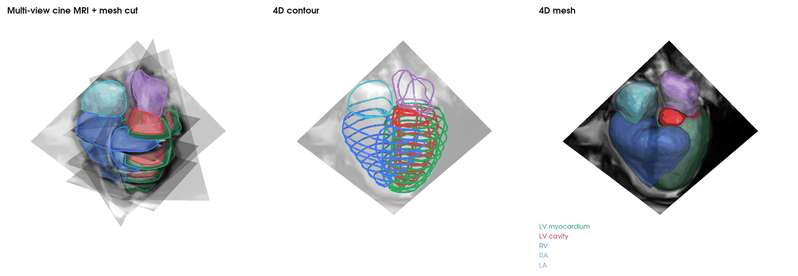
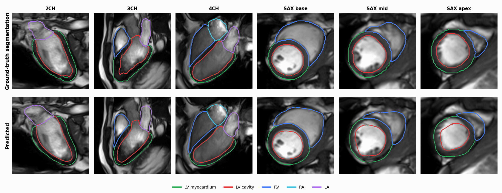

# Cardiac Digital Twin: Personalized 4D Whole-Heart Mesh Reconstruction from Cine MRI

Official implementation of **Personalized 4D Whole-Heart Mesh Reconstruction from Cine MRI via Multi-Scale Temporal Modeling and Differentiable Contour Rendering**.

📄 Paper: [arXiv:2607.01952](https://arxiv.org/abs/2607.01952) ([PDF](https://arxiv.org/pdf/2607.01952))

The source code will be released upon acceptance.

## Introduction

Cardiac digital twins require patient-specific anatomy that moves through the whole cardiac cycle. Cine MRI is the clinical standard for imaging cardiac motion, but it only gives a few sparse 2D views per time frame. Reconstructing a complete 3D+t heart from these slices is difficult for two reasons: the slices cover the heart only partially, and cardiac shape and motion are tightly coupled. Most existing methods first fit contours to the images and then build a mesh from them. They usually recover a static shape, a single cardiac phase, or only part of the heart, so they miss the dynamics of the full set of chambers.

We propose an end-to-end framework that learns a direct mapping from multi-view 2D cine MRI sequences to a temporally resolved whole-heart mesh. The output is a topology-consistent 4D mesh of the LV myocardium, LV cavity, right ventricle, right atrium and left atrium over the cardiac cycle, placed in the scanner coordinates of the input images.

## Method

- **End-to-end image-to-mesh reconstruction.** Multi-view cine MRI (2CH, 3CH, 4CH and the short-axis stack) is mapped directly to a deforming whole-heart mesh. No intermediate segmentation or contour fitting is needed at inference.
- **Differentiable contour rendering.** A contour renderer inspired by the Beer–Lambert attenuation principle projects the 3D+t mesh onto the imaging planes. This gives anatomy-aware supervision of the mesh deformation through contour-based losses.
- **Multi-scale temporal modeling.** Global, cycle-level dynamics are combined with local inter-frame coherence. The result is smooth, physiologically plausible mesh trajectories across the cardiac cycle.
- **Towards digital twins.** The reconstructed meshes keep the same topology over time, so they can be used directly in downstream simulation, such as proof-of-concept cardiac electrophysiology.

## Results

### 4D whole-heart mesh in scanner space

<p align="center">
  
  <br>
  <em>(If the GIFs fail to display, please open them directly in <a href="source"><code>source/</code></a>.)</em>
</p>

The animation shows one cardiac cycle and has three panels:
- **Multi-view cine MRI + mesh cut:** the cine MRI planes with the cross-sections of the reconstructed mesh.
- **4D contour:** the mesh contours on all imaging planes.
- **4D mesh:** the reconstructed whole-heart mesh.

The camera is fixed, so the motion you see is the heart beating in scanner space.

### Contour agreement with the ground-truth segmentation

<p align="center">
  
</p>

The reconstructed mesh is cut by each acquired cine MRI plane: 2CH, 3CH, 4CH, and basal, mid-ventricular and apical short-axis slices. The resulting contours (bottom row) are compared over the whole cardiac cycle with the ground-truth segmentation of the same images (top row).

## Citation

If you find this work useful, please cite:

```bibtex
@article{liu2026personalized,
  title   = {Personalized 4D Whole-Heart Mesh Reconstruction from Cine MRI via Multi-Scale Temporal Modeling and Differentiable Contour Rendering},
  author  = {Liu, Xiaoyue and Cang, Dongcheng and Yuan, Xiaohan and Chan, Mark Y. Y. and Sia, Ching-Hui and Li, Lei},
  journal = {arXiv preprint arXiv:2607.01952},
  year    = {2026}
}
```
